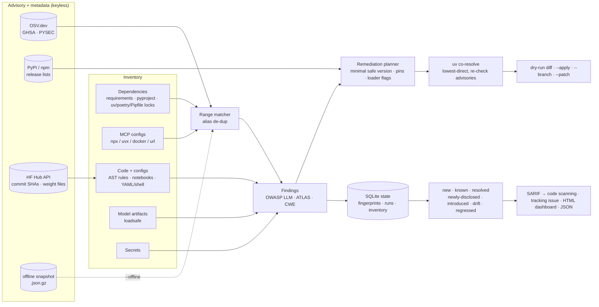

# aiwatch

**Find, fix and continuously monitor vulnerabilities in AI/LLM application stacks.**

`aiwatch` inventories the attack surface of an AI repo (ML/LLM dependencies, model artifacts, Hugging Face model references, MCP server configs and risky model-loading code) and matches it against **live OSV.dev advisories** (GHSA + PYSEC, PyPI and npm). It then **computes and applies fixes**: minimal safe version bumps that are co-resolved so they install together, commit-SHA pins for Hugging Face downloads, `weights_only=True`, `yaml.safe_load` and pinned MCP servers. It also **keeps watching**: a persisted baseline separates *newly disclosed* advisories from *known* ones and from *drift* (newly introduced risky patterns). A daily GitHub Action uploads SARIF to code scanning, keeps one tracking issue up to date and publishes an HTML dashboard.

[](https://github.com/sushmit-gujar/aiwatch/actions/workflows/ci.yml)
[](https://github.com/sushmit-gujar/aiwatch/actions/workflows/monitor.yml)
[](LICENSE)

> No API keys. Two runtime dependencies (`packaging`, plus `tomli` on 3.10). Defensive only: it reads manifests and code and never executes or loads what it scans.

**Live dashboard** (refreshed daily by the scheduled monitor): https://sushmit-gujar.github.io/aiwatch/ · demo run: [/demo/](https://sushmit-gujar.github.io/aiwatch/demo/)

## Why

AI stacks have their own vulnerability profile, and generic dependency scanners only see part of it:

- **The ML libraries themselves ship RCEs at a high rate.** In the OSV snapshot used here, the 17 tracked packages carry 386 de-duplicated advisories (vllm, mlflow, gradio, transformers and torch have the most). One example: [CVE-2025-32434](https://osv.dev/vulnerability/GHSA-53q9-r3pm-6pq6) showed that `torch.load(..., weights_only=True)` was itself bypassable before torch 2.6, so fixing the call site does not help without the bump. aiwatch reports both.
- **The risky part is often code and config, not the version.** Examples: `from_pretrained()` on a moving branch, `trust_remote_code=True`, `allow_pickle=True`, LangChain `allow_dangerous_deserialization` and `allow_dangerous_code`, `vllm serve --trust-remote-code`, and pickle-only model repos.
- **MCP servers are a new supply chain.** `npx -y some-server` runs whatever was published last (the rug-pull window). Known-vulnerable releases (e.g. `mcp-remote` [CVE-2025-6514](https://osv.dev/vulnerability/GHSA-6xpm-ggf7-wc3p), `server-filesystem` [CVE-2025-53109/53110](https://osv.dev/vulnerability/GHSA-q66q-fx2p-7w4m)) stay pinned in configs, and filesystem servers get rooted at `/`.
- **The data changes daily even when your code doesn't.** The useful question for a monitor is "what is *new* since yesterday, and why": a new advisory, a dependency change, or a code change.

## What it checks and fixes

| Surface | Detects | Automatic fix (`aiwatch fix`) |
|---|---|---|
| Python deps: `requirements*.txt`, `pyproject.toml` (PEP 621, Poetry, dependency-groups), `uv.lock`, `poetry.lock`, `Pipfile.lock` | Known advisories via OSV (GHSA/PYSEC, alias-deduplicated), unpinned AI/ML packages | Minimal safe bump, rewritten in place. With `--resolve`, uv co-resolves each manifest so the bumped set installs together. Lockfiles get the exact `uv lock --upgrade-package` command |
| MCP configs: `.cursor/mcp.json`, `.vscode/mcp.json`, `claude_desktop_config.json`, `mcp.json` (JSONC ok) | Vulnerable npm/PyPI server versions, unpinned `npx`/`uvx` servers, filesystem roots at `/` or `~`, plain-HTTP remotes, `alwaysAllow`/`autoApprove`, container images without a digest | Bump to the minimal safe version; pin floating servers to the current exact release |
| Model-loading code (`.py`, notebooks) | Unpinned HF `revision`, `trust_remote_code=True`, `torch.load` without `weights_only=True`, `np.load(allow_pickle=True)`, pickle/joblib/dill loads, LangChain `allow_dangerous_*`, unsafe `yaml.load`, Gradio `share=True` | `revision="<commit sha>"` (resolved from the Hub API), `weights_only=True`, `allow_pickle=False`, `yaml.safe_load`, `share=False` |
| Hugging Face refs | Repos that ship only pickle weights (no `.safetensors`) | Reported with a conversion suggestion |
| Serving/app configs (YAML, shell, Dockerfile, compose) | `trust_remote_code: true`, `--trust-remote-code` | Reported |
| Model artifacts (`.pt .bin .pkl .joblib .npy .safetensors .onnx .gguf .h5 …`) | Opcode-level pickle analysis and format checks via [**loadsafe**](https://github.com/sushmit-gujar/loadsafe) (optional extra) | Reported (do not load; convert to safetensors) |
| Secrets | OpenAI, Anthropic, HF, GitHub, AWS, Google, Groq, Replicate and Slack credentials (stored only as a SHA-256 prefix, never in clear) | Reported (rotate the key) |

Every fix carries a safety level: **`safe`** (patch bumps and pins that keep behaviour), **`review`** (minor/major bumps and loader-flag changes) or **`manual`**. `--max-safety safe` applies only the first group. Every finding maps to the **OWASP Top 10 for LLM Applications 2025**, **MITRE ATLAS** and CWE where the mapping is accurate (`aiwatch rules` prints them all; see the [rules table](#rules)).

## Quickstart

```bash
pip install "aiwatch[artifacts] @ git+https://github.com/sushmit-gujar/aiwatch.git"

aiwatch scan .                                  # live OSV data, text report
aiwatch scan . --sarif aiwatch.sarif --html report.html --fail-on high

aiwatch fix .                                   # dry run: prints a unified diff
aiwatch fix . --resolve --apply                 # co-resolve bumps with uv, write files, re-scan
aiwatch fix . --branch                          # same, committed on aiwatch/fix-<date> (never pushes)
aiwatch fix . --patch fix.patch --pr-body pr.md --max-safety safe

aiwatch monitor . --state .aiwatch/state.db --html dash.html --md issue.md   # new vs known vs resolved

aiwatch db snapshot . --out osv-snapshot.json.gz   # freeze advisory data for deterministic CI
aiwatch scan . --db osv-snapshot.json.gz --offline --as-of 2025-06-30          # time travel
```

## Architecture



**How the minimal safe version is chosen.** Candidates are the package index's non-yanked, non-prerelease releases above the current version. aiwatch prefers the smallest candidate that is past a *published* `fixed` version for every advisory that has one. This rule matters: `@modelcontextprotocol/server-filesystem` switched from CalVer (`2025.7.1`) to SemVer (`1.0.0`), so `1.0.0` merely falls outside the advisory ranges and is not a confirmed fix. If no candidate clears everything, aiwatch picks the one that leaves the fewest advisories and reports those as unfixed. `--fix-min-severity high` asks for the smallest bump that clears all high and critical advisories.

**Why `--resolve`.** Per-package minimal bumps are often mutually incompatible. With `--resolve`, each manifest is re-resolved by `uv pip compile --resolution lowest-direct`: vulnerable packages get floors and other pins stay exact, relaxed to `>=current` only when the resolver requires it. The resolved versions are then checked against the advisories again, and floors are raised until the set is clean.

**Why fingerprints are line-independent.** A finding's identity is `rule | file | stable key`, where the key is the advisory id plus package, or the normalised call. Inserting lines above a finding therefore does not make it "new", and the SARIF `partialFingerprints` keep code-scanning alerts stable across runs.

## Results

All numbers below come from committed runs: [`results/demo.json`](results/demo.json), [`results/osv-agreement.json`](results/osv-agreement.json) and [`results/public-repos.json`](results/public-repos.json). The demo runs offline against the committed snapshot [`data/osv-snapshot.json.gz`](data/osv-snapshot.json.gz) (OSV + PyPI/npm + HF data captured 2026-10-23 16:53 UTC). **CI re-runs it and fails if any number changes.** Environment: Python 3.12.15, Linux x86_64.

### Detect → monitor → drift → fix → re-scan on the deliberately vulnerable fixture

[`examples/vulnerable-llm-app`](examples/vulnerable-llm-app) is a harmless fixture (never installed or executed). It has old pins with real advisories, insecure loaders, a risky MCP config, fake keys and an inert PoC pickle that only calls `print`.

| Step | Findings | Advisories (packages) | Critical + high | Monitor result |
|---|---:|---:|---:|---|
| 1. Baseline with advisories published ≤ 2025-06-30 (`--as-of`) | 158 | 128 (11) | 91 | 158 baseline |
| 2. Same code, advisory data as of the snapshot | 287 | 257 (15) | 159 | **129 NEW, all *newly disclosed*** · 158 known |
| 3. Drift: add `app/finetune.py` + `llama-cpp-python==0.2.71` | 291 | 258 (16) | 162 | **4 NEW**: 3 *drift* (`trust_remote_code` on an unpinned revision, `torch.load(weights_only=False)`, unpinned HF revision) + 1 *introduced* ([CVE-2024-34359](https://osv.dev/vulnerability/GHSA-56xg-wfcc-g829) chat-template SSTI) · 287 known |
| 4. `aiwatch fix` (29 fixes, 7 files, [141-line patch](results/demo-fix.patch)) → re-scan | **19** | **0 (0)** | **8** | 0 new · **272 resolved** · 19 known |

The 19 findings left after the fix are the ones that need a human, and aiwatch deliberately does not auto-fix them. They are 2 `trust_remote_code` (now on pinned SHAs, downgraded to medium), the PoC pickle (critical, from loadsafe), 2 fake keys (rotate), the MCP filesystem server rooted at `/`, a plain-HTTP remote, `alwaysAllow`, an image without a digest, LangChain `allow_dangerous_*`, a `pickle.load`, 2 pickle-only HF repos, 2 serving configs with `trust_remote_code`, and 2 unpinned floating deps.

**Resolver-aware fixing.** The naive per-package bump of `requirements.txt` is **unsatisfiable**, because `langchain-community==0.3.27` requires `langchain<1.0.0` while the minimal safe langchain is 1.3.9. `aiwatch fix --resolve` co-resolved it in **3 rounds**. Along the way it raised `mcp` from 2.0.0 to 2.2.0 after the resolver's first pick was itself vulnerable, and moved `numpy 1.26.4 → 2.0.0` because `vllm>=0.32` needs it. Both fixed manifests resolve with `uv pip compile` (Python 3.12, manylinux x86_64), and the re-scan reports 0 advisories.

**Scan time** (12-file fixture, 19 components). Offline with the snapshot: **0.03 s** in-process and **0.14 s** wall time for the whole CLI. Live with a cold cache: **4.7 s**, of which 2.9 s is OSV/PyPI/npm/HF fetching. This is network-bound: separate cold runs took about 3 s, and one outlier took 33 s. Warm cache: **0.05 s**.

### Accuracy vs OSV.dev's own matcher

For **900** distinct pinned `(package, version)` pairs (the fixture plus the five public manifests below), aiwatch's local range evaluation was compared with OSV.dev's server-side `querybatch` result for the exact version. They **agree on 899/900 (99.9%)**, including 86 of the 87 pairs that have advisories on either side. The single disagreement is `vllm==0.5.0`, where the server also returns PYSEC-2025-42 and PYSEC-2025-50. Both records' own ECOSYSTEM ranges start at 0.6.4/0.6.5 and their version lists exclude 0.5.0, but the server matches them through GIT commit ranges, which aiwatch ignores by design.

Building this check found a real bug, since fixed: when GHSA and PYSEC disagree on a fix version (mlflow CVE-2023-6568: GHSA says 2.9.0, PYSEC says 2.9.1), merged advisories now use the **union** of affected ranges. A false negative is worse than an extra bump.

### Read-only scan of popular open-source LLM apps

Only the listed manifests were downloaded, at the pinned commit, and scanned with live OSV data (2026-10-23). Nothing was installed, and no issues or PRs were opened.

| Repo @ commit | Manifests | Pinned / total | Vulnerable pkgs | Advisories | Crit / high | Most affected |
|---|---|---:|---:|---:|---:|---|
| open-webui/open-webui @ `91ea4e3` | `backend/requirements.txt` | 115 / 115 | 17 | 128 | 9 / 54 | pypdf 6.7.5 (43), pillow 12.3.0 (39) |
| AUTOMATIC1111/stable-diffusion-webui @ `82a973c` | `requirements_versions.txt` | 34 / 35 | 10 | 171 | 19 / 98 | pillow 9.5.0 (52), gradio 3.41.2 (41), transformers 4.30.2 (29) |
| zylon-ai/private-gpt @ `0f6a2de` | `pyproject.toml`, `uv.lock` | 351 / 497 | 38 | 242 | 7 / 108 | pillow 10.4.0 (51), pypdf 6.7.0 (50) |
| langgenius/dify @ `2b35144` | `api/pyproject.toml`, `api/uv.lock` | 500 / 676 | 7 | 20 | 1 / 4 | pypdf 6.19.0 (8), pydantic-ai-slim 2.31.0 (5) |
| oobabooga/text-generation-webui @ `c93f887` | `requirements/full/requirements.txt` | 10 / 36 | 1 | 4 | 0 / 3 | mcp 1.27.0 (4) |

Read these as a snapshot of a moving target, not a verdict on the projects. Many advisories were published days earlier (pillow 13.0.0 fixed a large batch disclosed 2026-10-21), and not all are reachable in each app. That gap is the case for continuous monitoring. For requirements files `aiwatch fix` can rewrite pins (e.g. 124 of 128 open-webui findings). For lockfile-managed repos it emits the `uv lock --upgrade-package` commands instead.

## Continuous monitoring (GitHub Action)

```yaml
# .github/workflows/aiwatch.yml in your repo
on:
  schedule: [{ cron: "17 11 * * *" }]
  workflow_dispatch:
permissions: { contents: read, security-events: write, issues: write }
jobs:
  aiwatch:
    runs-on: ubuntu-latest
    steps:
      - uses: actions/checkout@v4
      - uses: sushmit-gujar/aiwatch@main
        with:
          path: .
          fail-on-new: none        # or high: fail when a NEW high+ finding appears
```

Each run:

1. Restores the SQLite state from the Actions cache. Every run saves under a new key and the next run restores the latest, so daily runs keep it alive.
2. Scans with **live** OSV, PyPI, npm and HF data, then diffs against the stored fingerprints. Each new finding is classified as *newly-disclosed* (same package version, new advisory), *introduced* (a dependency changed), *drift* (a new risky code/config/MCP pattern) or *regressed* (a fixed finding came back). Findings that disappeared are marked *resolved*.
3. Uploads **SARIF** to GitHub code scanning, with stable `partialFingerprints` so alerts don't churn.
4. **Opens or updates one tracking issue** when something is new (labelled `aiwatch`, with a comment per run that has new findings), silently refreshes the counts otherwise, and closes the issue when everything is resolved.
5. Writes the HTML dashboard and JSON report (and the job summary). This repo's [`monitor.yml`](.github/workflows/monitor.yml) runs it daily on the demo app and publishes the dashboard to GitHub Pages.

Outputs: `new`, `known`, `resolved`, `total`, `issue-url`.

## Rules

| ID | Sev | Rule | OWASP LLM 2025 | MITRE ATLAS | CWE |
|---|---|---|---|---|---|
| AW100 | adv. | Vulnerable dependency (known advisory) | LLM03 | AML.T0010.001 | CWE-1395 |
| AW101 | low | AI/ML dependency is not pinned | LLM03 | AML.T0010.001 | CWE-1357 |
| AW102 | adv. | Vulnerable MCP server package | LLM03 | AML.T0010.005 | CWE-1395 |
| AW200 | med/high | `torch.load` without `weights_only=True` | LLM03, LLM04 | AML.T0011.000 | CWE-502 |
| AW201 | med | HF download without a pinned revision | LLM03 | AML.T0010.003 | CWE-494 |
| AW202 | high/med | `trust_remote_code=True` (medium once pinned) | LLM03 | AML.T0010.003, AML.T0011.000 | CWE-94 |
| AW203 | high | `numpy.load(allow_pickle=True)` | LLM03 | AML.T0011.000 | CWE-502 |
| AW204 | med | pickle / joblib / dill / cloudpickle loads | LLM03 | AML.T0011.000 | CWE-502 |
| AW205 | high | LangChain `allow_dangerous_deserialization=True` | LLM03, LLM04 | AML.T0011.000 | CWE-502 |
| AW206 | high | `allow_dangerous_code` / `allow_dangerous_requests` | LLM05, LLM06 | | CWE-94 |
| AW207 | med | `yaml.load` without a safe Loader | | | CWE-502 |
| AW208 | med | Gradio `launch(share=True)` | | AML.T0049 | CWE-668 |
| AW209 | per loadsafe | Model artifact issue (loadsafe rule in details) | LLM03, LLM04 | AML.T0010.003, AML.T0011.000 | CWE-502 |
| AW210 | low | Pickle artifact, not deep-scanned (loadsafe missing) | LLM03 | AML.T0011.000 | CWE-502 |
| AW211 | med | Referenced HF repo ships only pickle weights | LLM03 | AML.T0010.003, AML.T0011.000 | CWE-502 |
| AW212 | high | `trust_remote_code` in serving/app config | LLM03 | AML.T0010.003, AML.T0011.000 | CWE-94 |
| AW300 | med | MCP server not version-pinned | LLM03 | AML.T0010.005, AML.T0011.002 | CWE-494 |
| AW301 | high | MCP filesystem server with a broad root | LLM06 | | CWE-732 |
| AW302 | med | Remote MCP server over plain HTTP | LLM02 | | CWE-319 |
| AW303 | low | MCP container image not pinned by digest | LLM03 | AML.T0010.004 | CWE-494 |
| AW304 | med | MCP `alwaysAllow` / `autoApprove` | LLM06 | | CWE-862 |
| AW400 | high | Hard-coded credential | LLM02 | AML.T0055 | CWE-798 |

"adv." = severity taken from the advisory: the GHSA label when present, otherwise the CVSS v3 base score computed locally.

## Limitations

- **Advisory matching needs exact versions.** Ranges like `openai>=1` are reported as unpinned (AW101) rather than guessed. Use a lockfile, or `--resolve` to produce one consistent set. Transitive dependencies are covered only when a lockfile is present.
- **Code rules are static and syntactic.** They see literal arguments, not data flow, so `from_pretrained(name_var)` is not checked. Notebook findings are reported but not auto-fixed.
- **`--resolve` needs `uv` and network access to PyPI metadata,** and resolves for one target Python and platform (default 3.12, manylinux x86_64).
- **A fix that clears advisories can still break your app.** That is why minor and major bumps and loader-flag rewrites are labelled `review`. Run your tests on the PR branch.
- **GIT commit ranges in OSV records are ignored.** See the accuracy section for the one place this disagrees with OSV.dev's server.

## Reproduce

```bash
pip install -e ".[dev,artifacts]"
pytest -q                                  # 27 tests, offline
python evals/demo.py [--live]              # results/demo.json, demo-fix.patch, dashboards
python evals/osv_agreement.py              # needs network (api.osv.dev)
python evals/public_repos.py               # needs network (raw.githubusercontent.com, api.osv.dev)
AIWATCH_NETWORK=1 pytest tests/test_resolve.py   # needs uv + PyPI
```

## References

- OSV.dev API (`/v1/query`, `/v1/querybatch`) and OSV schema range semantics: https://google.github.io/osv.dev/api/ · https://ossf.github.io/osv-schema/
- OWASP Top 10 for LLM Applications 2025: https://genai.owasp.org/llm-top-10/
- MITRE ATLAS (AI Supply Chain Compromise AML.T0010.*, User Execution AML.T0011.*): https://atlas.mitre.org/
- PyTorch `torch.load` weights_only RCE, CVE-2025-32434: https://osv.dev/vulnerability/GHSA-53q9-r3pm-6pq6
- llama-cpp-python chat-template SSTI, CVE-2024-34359: https://osv.dev/vulnerability/GHSA-56xg-wfcc-g829
- mcp-remote OS command injection, CVE-2025-6514: https://osv.dev/vulnerability/GHSA-6xpm-ggf7-wc3p
- MCP security cheat sheet (pinning, least privilege): https://cheatsheetseries.owasp.org/cheatsheets/MCP_Security_Cheat_Sheet.html
- Sibling projects: [loadsafe](https://github.com/sushmit-gujar/loadsafe) (artifact scanning engine used here) · [mcp-warden](https://github.com/sushmit-gujar/mcp-warden) (runtime MCP gateway)

## License

MIT © Sushmit Gujar
